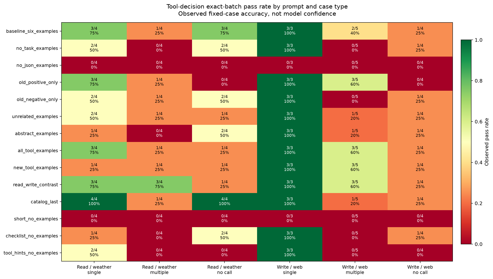

# Experiment 3 results

Recorded **336 of 336** model responses. Each case has one greedy response. Exact batch matching ignores call order and accepts the read_file default max_chars of 10000.

| Variant | Description | Exact batches | Valid batch schema | Read / weather | Write / web |
| --- | --- | --- | --- | --- | --- |
| [baseline_six_examples](../results/baseline_six_examples.md) | Experiment 2 baseline; catalog expanded to four tools | 13/24 | 16/24 | 7/12 | 6/12 |
| [no_task_examples](../results/no_task_examples.md) | Baseline rules without task examples | 8/24 | 13/24 | 4/12 | 4/12 |
| [no_json_examples](../results/no_json_examples.md) | Describe the JSON structure in prose, no JSON examples | 0/24 | 0/24 | 0/12 | 0/12 |
| [old_positive_only](../results/old_positive_only.md) | Baseline with only positive read/weather examples | 10/24 | 15/24 | 4/12 | 6/12 |
| [old_negative_only](../results/old_negative_only.md) | Baseline with only no-call examples | 9/24 | 14/24 | 5/12 | 4/12 |
| [unrelated_examples](../results/unrelated_examples.md) | Examples use other realistic, unavailable tools | 9/24 | 13/24 | 4/12 | 5/12 |
| [abstract_examples](../results/abstract_examples.md) | Examples use abstract, unavailable tool names | 8/24 | 13/24 | 3/12 | 5/12 |
| [all_tool_examples](../results/all_tool_examples.md) | Examples cover all four available tools | 12/24 | 17/24 | 5/12 | 7/12 |
| [new_tool_examples](../results/new_tool_examples.md) | Examples cover write and web but not read or weather | 10/24 | 15/24 | 3/12 | 7/12 |
| [read_write_contrast](../results/read_write_contrast.md) | Examples contrast reading and writing and cover all tools | 14/24 | 19/24 | 7/12 | 7/12 |
| [catalog_last](../results/catalog_last.md) | Baseline examples precede the tool catalog | 14/24 | 17/24 | 9/12 | 5/12 |
| [short_no_examples](../results/short_no_examples.md) | Short instruction without task examples | 0/24 | 0/24 | 0/12 | 0/12 |
| [checklist_no_examples](../results/checklist_no_examples.md) | Baseline rules with a generic coverage checklist | 7/24 | 12/24 | 3/12 | 4/12 |
| [tool_hints_no_examples](../results/tool_hints_no_examples.md) | Baseline rules plus descriptions distinguishing similar tools | 5/24 | 10/24 | 2/12 | 3/12 |

Read/weather cases are reused from Experiment 2; write/web includes mixed-tool and no-call cases. All variants receive all four tool schemas, but examples differ. Example tool names may still be present in model training.

The heatmap shows measured case pass rates, not model confidence or a confidence interval. The cases are a small fixed set, so these numbers do not establish general reliability.

See [findings and limitations](findings.md), [case-by-case evaluation](../results/eval_table.md), and [raw JSONL](../results/runs.jsonl).

